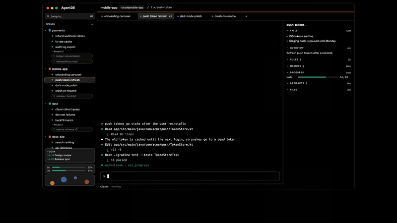

<h1 align="center">AgentDE</h1>

<p align="center"><b>A small, native macOS home for your terminal agents.</b><br>
Run a dozen Claude Code and Codex sessions side by side, see at a glance which one needs you,<br>and pick up any of them after a quit, an update or a crash.</p>

<p align="center">
  <a href="LICENSE"></a>
  
  
  <a href="https://github.com/AgentDE/agentde/releases"></a>
</p>

<p align="center"><a href="#install">Install</a> · <a href="docs/GUIDE.md">Guide</a> · <a href="docs/EXTENDING.md">Extending</a> · <a href="https://agentde.github.io/agentde">Website</a> · <a href="https://github.com/AgentDE/agentde/issues">Issues</a></p>

<p align="center"></p>

- **Native and light.** SwiftUI and AppKit, no Electron. Under 100 MB of memory (as Activity Monitor shows it) with a few groups loaded, under 1% CPU when idle.
- **Knows what each agent is doing.** A dot per tab: working, needs you, or done, with no setup. Notifications when an agent waits on you.
- **Tabs that don't die.** Every tab's shell runs in its own small holder process, so agents keep working when you quit, update or crash.
- **A viewer above the chat.** ⌘-click any path or link an agent prints to see the file, page, diff, PDF or video right there.
- **Workstreams.** Agents keep a shared record of each piece of work (overview, rules, memory, questions for you, progress, files) through an MCP server, shown beside the chat.
- **Extensible.** Native extensions in Swift, or JSON plugins for widgets, links and themes.
- **Built for vibe coding.** Yours to change however you want: point your agent at the source. It comes with notes for agents (`CLAUDE.md`) and a map of the code (`docs/ARCHITECTURE.md`).

## Install

Runs on macOS 14 or later. Building needs macOS 15.6 or later with the Xcode Command Line Tools 26 or newer (`xcode-select --install`; full Xcode isn't needed), and tabs need `claude` or `codex` on your `PATH`.

```bash
git clone https://github.com/AgentDE/agentde && cd agentde
make signing                    # once: so macOS remembers your permission answers
make install                    # about 4 minutes the first time
make register-workstream YES=1  # once: the workstream MCP server and hooks (run without YES=1 to see the changes first)
```

The full steps, what each one changes, and uninstalling: [Guide → Install](docs/GUIDE.md#install).

## The repos

| Repo | What |
|---|---|
| [agentde](https://github.com/AgentDE/agentde) | The app: groups, tabs, agent status, the viewer, search, the extension API |
| [workstream-mcp](https://github.com/AgentDE/workstream-mcp) | The MCP server behind workstreams. Works with plain Claude Code or Codex too, no app needed |
| [agentde-workstreams](https://github.com/AgentDE/agentde-workstreams) | The workstream panel beside each chat, and the Usage widget |
| [agentde-widgets](https://github.com/AgentDE/agentde-widgets) | The sidebar widget spot, the Calendar widget, and widgets from JSON plugins |
| [agentde-linear](https://github.com/AgentDE/agentde-linear) | Linear tickets in workstreams, and a widget with your open issues |

## Learn more

- **[Guide](docs/GUIDE.md):** everything AgentDE does, every key and setting, troubleshooting.
- **[Extending](docs/EXTENDING.md):** write a native extension or a JSON plugin.
- **[Architecture](docs/ARCHITECTURE.md):** how it works inside.
- **[Roadmap](https://github.com/AgentDE/agentde/issues?q=is%3Aopen+label%3Aplanned):** what's planned, as issues labeled `planned`.
- **[CLAUDE.md](CLAUDE.md):** notes for agents working on this repo.

## License

MIT. See [LICENSE](LICENSE).
